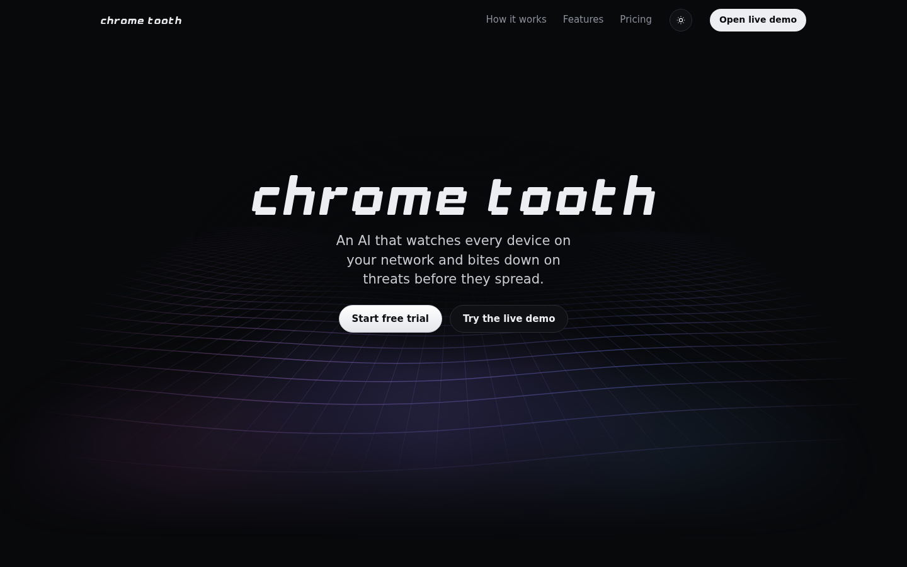
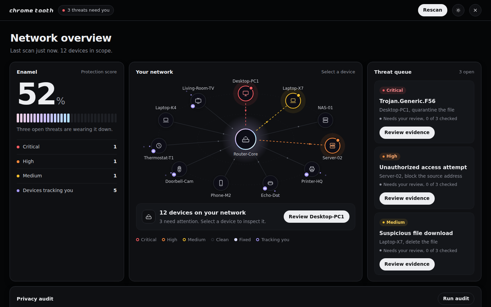
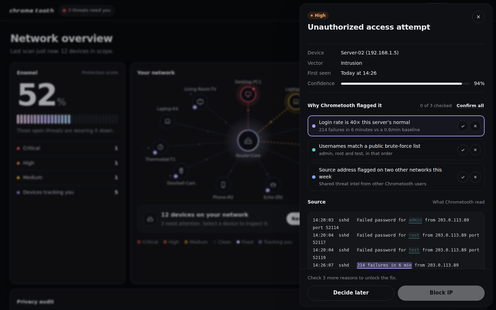

# chrome tooth

AI threat detection you can actually check. An interactive product prototype by [Ben Woods](https://benwoods.art).

**Live:** https://chrometooth.vercel.app



## What it is

Chrometooth is a concept for a home and small-team security product. An AI watches every device on your network, explains what it found in plain language, shows the exact evidence behind each flag, and only fixes things once you've reviewed them.

The prototype is fully interactive: a marketing site plus a working dashboard demo.



## Features

- **Network map.** Every device orbits the router. Threats glow in severity color, fixed devices turn chrome, and a radar sweep runs on each scan.
- **Evidence you can check.** Each reason the AI flagged a threat links both ways to the exact log lines behind it.
- **Review gate.** Fixes stay locked until every reason is confirmed or disputed. "Confirm all" covers the quick case.
- **Your rules.** Confidence floor, never-block-my-network, login limits and more, checked live as pass, warning or hard stop.
- **Check something.** Paste an email, text, job offer or log. The AI returns a verdict, highlights the words behind each finding and flags what's missing.
- **Privacy audit.** Finds smart TVs (ACR), voice assistants, cameras and thermostats sending data home, with block-at-router or turn-it-off-yourself steps.
- **Shields.** Job scam filter, AI call screener, scam text filter and per-signup email aliases.
- **Activity log and incident report.** Every AI finding and human decision is recorded, then drafted into a copyable report.
- **The bite.** Resolving a threat takes a bite out of its card. Enamel, the protection score, climbs to 100% as you clear threats.



## Design notes

- **One signature interaction**, the bite, with everything else kept quiet.
- **Color carries meaning.** Red, orange and yellow mean security severity, violet means privacy tracking, chrome means fixed, and category colors link each AI reason to its highlighted source.
- **Custom pixel wordmark** built on a strict grid, with a polished-chrome accent system drawn from the brand.
- **Built to a quality floor:** light and dark modes, responsive down to 375px, keyboard access with visible focus, reduced-motion support and plain, verb-first copy.

## Tech

A single self-contained `index.html` with vanilla JS, SVG and Canvas. No framework and no build step. Fonts are Instrument Sans and Geist Mono from Google Fonts.

### Live AI

"Check something" calls Claude when the page runs inside claude.ai. Anywhere else it switches to an honest **Demo mode** and analyzes the four built-in examples with saved results. See `CLAUDE.md` for how to add a serverless endpoint for live AI on your own domain.

## Run locally

```bash
npx serve .
# or just open index.html in a browser
```

## Deploy

Import the repo into Vercel as a static site, with no framework preset and no build command. Every push to `main` redeploys.

---

All companies, IP addresses, phone numbers and threats in the demo are fictional. IPs use reserved documentation ranges.
